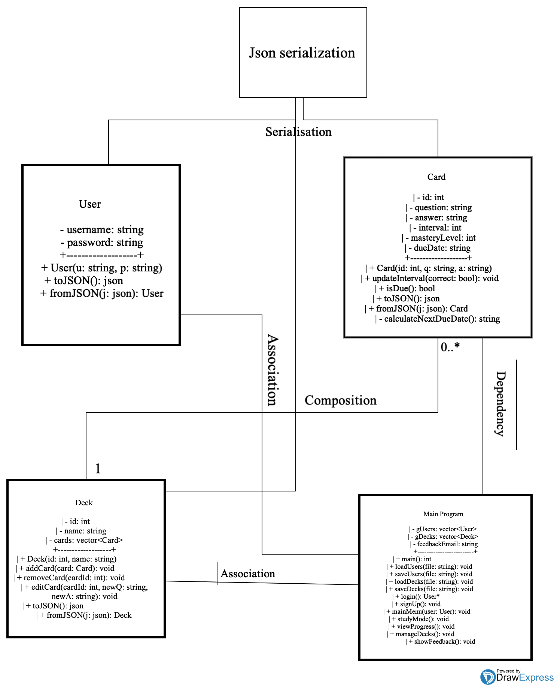

# Flashies

[](../../actions/workflows/ci.yml)

Flashies is a flashcard app built around **active recall** and **spaced repetition**. It has two front ends that share the same JSON data files:

- **C++ console app** (`flashcards`): log in, study due cards, track progress and manage decks. Changes are saved back to `users.json` and `decks.json`.
- **Web app** (`index.html` + `script.js`): a browser UI with login and sign-up, a study screen, a deck editor, and a mastery chart drawn with Chart.js.



## How it works

| Class | Responsibility |
|-------|----------------|
| `Card` | A question/answer pair with an `interval`, a `masteryLevel` and a `dueDate`. `updateInterval(correct)` runs the spaced-repetition step. |
| `Deck` | A named collection of cards with `addCard`, `removeCard` and `editCard`. |
| `User` | A username and password. |

All three classes serialize to and from JSON with `toJSON()` / `fromJSON()` (via [nlohmann/json](https://github.com/nlohmann/json)).

**The spaced-repetition rule** (`Card::updateInterval`):

- **Correct answer:** `masteryLevel += 1` and `interval *= 2` (1 → 2 → 4 → 8 … days)
- **Wrong answer:** `masteryLevel = 0` and `interval = 1`

A card counts as **mastered** once `masteryLevel >= 3`. The "View Progress" screens in both front ends use that threshold.

**A study session:** the app picks a random due card and shows the question. You try to recall the answer, reveal it, and say whether you got it right. The app then updates the card's interval and saves it.

> Note: `Card::isDue()` currently always returns `true`, and `calculateNextDueDate()` returns a fixed placeholder date, so every card is always due. Comparing real dates is the obvious next step.

## Project layout

```
Card.h/.cpp  Deck.h/.cpp  User.h/.cpp   core model
main.cpp                                console app (menus, JSON load/save)
index.html  script.js  styles.css       web front end
users.json  decks.json                  sample data (shared by both front ends)
test_*.cpp                              Catch2 unit tests
catch.hpp  json.hpp                     vendored single-header libraries
CMakeLists.txt                          build + test definitions
.github/workflows/ci.yml                GitHub Actions CI
```

## Building and running

Requires CMake 3.14 or newer and a C++17 compiler.

```bash
cmake -S . -B build
cmake --build build
```

Run the console app from the repo root so it finds `users.json` and `decks.json`:

```bash
./build/flashcards
```

### Web app

`script.js` loads the JSON files with `fetch`, so the page has to be served over HTTP rather than opened as a file:

```bash
python3 -m http.server 8080
```

Then open <http://localhost:8080/index.html>. On Windows, `launch.bat` compiles the console app, starts it, and opens the web app.

Changes made in the web app stay in the browser's memory and are not written back to the JSON files.

## Tests

There are 14 Catch2 test cases in four binaries:

| Binary | Covers |
|--------|--------|
| `test_card` | constructor defaults, interval updates on correct and wrong answers, `isDue`, JSON round trip |
| `test_deck` | constructor, add, remove and edit card, JSON round trip |
| `test_user` | constructor, JSON round trip |
| `test_app` | `saveUsers`/`loadUsers` and `saveDecks`/`loadDecks` from `main.cpp` |

```bash
ctest --test-dir build --output-on-failure
```

`test_app` compiles `main.cpp` with `FLASHIES_NO_MAIN` defined, so Catch2 can supply `main()`.

## Continuous integration

On every push to `main` and on every pull request, GitHub Actions configures, builds and runs `ctest` on Ubuntu, macOS and Windows.

## Security note

This is a learning project. Passwords are stored and compared **in plain text** in `users.json`, so don't use a real password.

## Feedback

Open an issue, or use the Feedback screen in the app.
